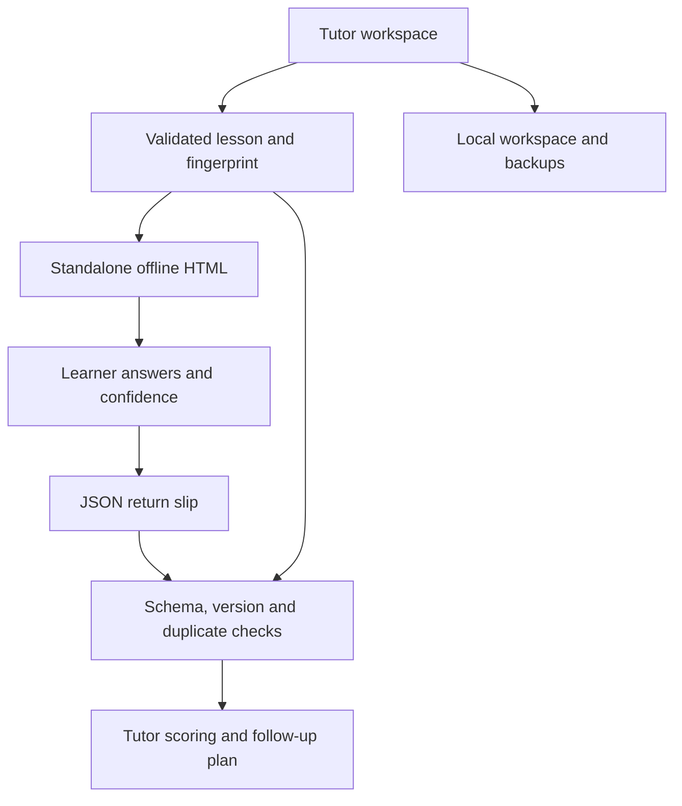

# SabaqSlip

**Small offline lessons. Private return slips. A useful next tutoring session.**


[Open SabaqSlip](https://sabaqslip.vercel.app/) · [Devpost draft](https://devpost.com/software/sabaqslip) · [Research](docs/RESEARCH.md) · [Validation](docs/VALIDATION.md) · [Security](SECURITY.md)

SabaqSlip is an English/Urdu workspace for community tutors. Create a short activity, share one self-contained HTML file, and import the learner's small JSON return slip. The next-session plan connects each question to its explanation and follow-up prompt, ordered using the latest answers and self-reported confidence.

Built for Neighborhood Hacks 2026, **Education & Access**. It is a working prototype; a local pilot or measured learning improvement has not been established.

## What you can do

| Tutor workspace | Offline learner activity |
| --- | --- |
| Start from four original English/Urdu lessons | Open a self-contained HTML file |
| Author 1–8 questions, answer keys and teaching prompts | Read, answer and record confidence |
| Export, back up, restore and print lesson materials | Review feedback and save a JSON return slip |
| Validate returns and inspect the next-session plan | Exchange the small file through an existing private channel |

Starter lessons cover fractions, percentages, reading evidence and equations. The interface includes Urdu RTL layouts, semantic controls, visible keyboard focus, dialog focus management and a skip link.

## Try the workflow

1. Choose a starter lesson, or create an edited copy.
2. Preview it or export **offline HTML**. Open the saved file in a full browser; messaging apps and file previews may not execute HTML.
3. Use a learner code such as `B07`, answer each question and save the return slip.
4. Give the JSON file to the tutor through an existing private channel. The file does not send itself.
5. Import it in the tutor workspace and inspect answer details and follow-up prompts.

**How it works → Try clearly labeled example returns** provides fictional demonstration data, separated from real returns.

## Architecture



React and Vite deliver the workspace. Zod validates bounded lesson/return formats, while Noble Hashes supplies SHA-256 lesson-version fingerprints. The exported learner activity embeds its content and runtime without remote scripts, fonts or APIs. No account, paid API or cloud answer database is required.

Fingerprints detect lesson-version mismatches; they do not authenticate a learner. Tutor-side scoring is based on validated returns, not an AI service.

## Run locally

Use Node.js 22.12 or newer and npm.

```sh
git clone https://github.com/adeelfalaksher900-creator/SabaqSlip.git
cd SabaqSlip
npm ci
npm run dev -- --host 0.0.0.0 --port 4173
```

| Command | Purpose |
| --- | --- |
| `npm test` | Core lesson/return-format tests |
| `npm run build` | Production workspace, offline example and Sites packaging |
| `npm run test:sites` | Optional Sites worker/package tests |
| `npm run preview -- --host 0.0.0.0 --port 4174` | Inspect the production build |

## Deployment

The static application is emitted to `dist/client/`. The build also creates `offline-example.html`, example JSON files and a revisioned service worker. Vercel can host `dist/client/`; use the repository's `vercel.json` in the deployment root. The optional Sites runtime remains available and is separate from the tutoring data flow.

No environment variables, database migration or inference key is required for the core workflow.

## Privacy and boundaries

This is formative practice, not a secure exam or a diagnosis of ability. The exported HTML contains its answer key. Returns are self-reported and unsigned; confidence starts a conversation rather than proving understanding.

Workspace data stays in local browser storage, which is **not encrypted**. Protect downloaded lessons, returns and backups. Hosting still receives ordinary page requests. A JavaScript-capable browser and a way to exchange files are required. See [SECURITY.md](SECURITY.md) for the full boundary.

## Project map

| Path | Purpose |
| --- | --- |
| `src/App.jsx` | Tutor workspace and return management |
| `src/Builder.jsx` | Lesson authoring |
| `src/Learner.jsx` | Learner activity interface |
| `src/lib/core.js` | Schemas, fingerprints, scoring and validation |
| `src/lib/export.js` | Standalone HTML export |
| `src/lib/i18n.js` | English/Urdu copy |
| `scripts/build-offline.mjs` | Offline example and generated assets |
| `tests/` | Core and Sites packaging tests |

## Contributing

Open an issue with the affected workflow, expected behavior and a small fictional lesson or return slip. For a change, create a branch, run `npm test`, `npm run build` and `npm run test:sites`, then open a pull request. Do not include real learner identities, private return files or credentials in an issue.

## License and credits

[MIT](LICENSE) covers original code and lesson text. Dependencies and fonts retain their licenses; see [third-party notices](public/THIRD_PARTY_NOTICES.txt).

The project was developed during the event with AI coding and design assistance; AI is not needed at runtime. No generated learner evidence, interviews, testimonials or impact figures are used.
